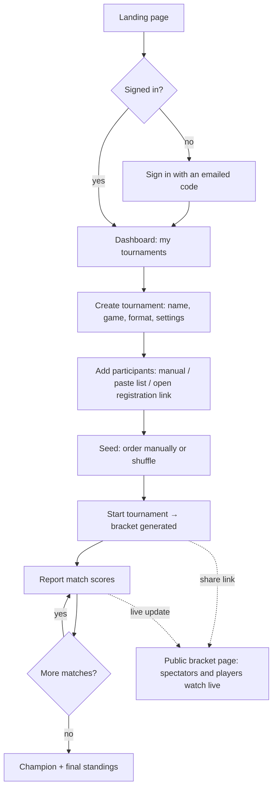

# Laurel — Roadmap

## 1. Tech stack (and why)

| Layer | Choice | Why |
|---|---|---|
| Language | **TypeScript** | One language for frontend + backend; types catch bracket-logic bugs early. |
| Framework | **Next.js 16 (App Router)** | Pages, API routes and server rendering in one project. Shared bracket pages render fast and are SEO-friendly. |
| Styling | **Tailwind CSS** | Fast to build a clean UI without writing CSS files. |
| Database | **PostgreSQL** | Tournaments are highly relational (tournament → participants → matches → next match). Transactions keep score reporting consistent. |
| ORM | **Prisma** | Type-safe queries, easy migrations, Prisma Studio for inspecting data. |
| Validation | **Zod** | Validates every API input. |
| Auth | **Neon Auth** (Managed Better Auth) | Email one-time codes, no passwords; free up to 60k monthly users; Neon sends the emails. |
| Realtime (Phase 4) | **Pusher** or **Ably** (or Supabase Realtime) | Vercel serverless can't hold WebSockets itself; these services do it for you. |
| Testing | **Vitest** (unit) + **Playwright** (end-to-end) | Bracket generators are pure functions, so they're ideal for unit tests. |

### Hosting

| What | Where | Cost to start |
|---|---|---|
| App | **Cloudflare Workers** via OpenNext (moved from Vercel, see §4) | Free |
| Database | **Neon** (serverless Postgres) | Free tier |
| Images / logos (later) | Vercel Blob or Cloudflare R2 | Free tier |
| Error tracking | Sentry | Free tier |
| Domain | Any registrar (Cloudflare, Namecheap) | ~$10/yr |

Alternatives: **Supabase** (Postgres + auth + realtime in one, so it replaces Neon + Pusher), or **Railway/Render** if you want a long-running server for WebSockets.

---

## 2. Product flow

### User flow



### Tournament lifecycle (state machine)

```
DRAFT ──start──▶ IN_PROGRESS ──last match reported──▶ COMPLETED
  │                                     (Phase 2 adds REGISTRATION between DRAFT and IN_PROGRESS)
  └─ edit name / participants / seeds only allowed here
```

### Match lifecycle

```
PENDING (waiting on earlier matches) ──both players known──▶ READY ──score reported──▶ COMPLETED
                                                                        │
                                                    winner copied into nextMatch (slot 1 or 2)
```

### Request / data flow

```
Browser ──▶ Next.js page (server component) ──Prisma──▶ Postgres     (reads)
Browser ──fetch──▶ /api/... route ──Zod validate──▶ Prisma transaction ──▶ Postgres   (writes)
                                   └──(Phase 4) publish event ──▶ Pusher ──▶ all open bracket pages
```

### Pages

| Route | Purpose | Status |
|---|---|---|
| `/` | Landing | ✅ skeleton |
| `/tournaments` | Browse / list | ✅ skeleton |
| `/tournaments/new` | Create form | ✅ skeleton |
| `/tournaments/[id]` | Bracket view + score reporting | ✅ skeleton |
| `/dashboard` | My tournaments | ✅ |
| `/tournaments/[id]/edit` | Edit, rename players, reset, delete | ✅ |
| `/tournaments/[id]/join` | Self-registration link | ✅ |
| `/u/[username]` | Player profile + history | Phase 5 |

### API

| Method | Route | Purpose | Status |
|---|---|---|---|
| GET/POST | `/api/tournaments` | List / create | ✅ |
| POST | `/api/tournaments/[id]/start` | Generate bracket | ✅ |
| PATCH | `/api/matches/[id]` | Report score, advance winner | ✅ |
| PATCH/DELETE | `/api/tournaments/[id]` | Edit / delete | ✅ |
| POST/DELETE | `/api/tournaments/[id]/participants` | Add / remove / reseed | Phase 2 |
| POST | `/api/matches/[id]/undo` | Undo a result (PATCH on a finished match corrects it) | ✅ |
| POST | `/api/tournaments/[id]/reset` | Back to draft, delete bracket | ✅ |

---

## 3. Roadmap

### Phase 0 — Setup (½ day) ✅ *skeleton done*
- [x] Next.js + TS + Tailwind + Prisma project
- [x] Database schema (User, Tournament, Participant, Match)
- [x] Local Postgres via Docker
- [x] `git init`, push to GitHub (`main` = stable, `dev` = work in progress)
- [ ] Add ESLint + Prettier

### Phase 1 — MVP: working brackets (1–2 weeks)
- [x] Create a tournament with a participant list
- [x] Single-elimination generation with seeding and byes
- [x] Round-robin generation (circle method)
- [x] Report scores, auto-advance winners, finish tournament
- [x] Round-robin **standings table** (W/L, score difference, tiebreakers)
- [x] Unit tests (Vitest): every format simulated end to end for 2–64 players (`npm test`)
- [x] Shuffle-seeds option
- [x] Loading / error / 404 pages
- [x] **Deploy to Cloudflare + Neon**: live at https://laurel.seanlorico9.workers.dev

### Phase 2 — Accounts & ownership (1–2 weeks)
- [x] Sign in with an emailed one-time code (Neon Auth)
- [x] Only the tournament owner can manage it (start, scores, edit, reset, delete)
- [x] Dashboard of "my tournaments" (`/dashboard`, grouped live / drafts / completed)
- [x] Edit / delete tournaments; add/remove/reorder participants while in DRAFT (rename any time); reset to draft
- [x] Undo or correct a reported score (refuses if a later match already depends on it)
- [x] Public vs. unlisted vs. private visibility (private = owner only, no sign-up link; non-public pages are `noindex`)
- [x] Registration link: players join themselves with just a name (organizer opens/closes it)
- [ ] Registration cap and close date
- [ ] Rate limiting on write endpoints, the public join endpoint first (Cloudflare Workers rate-limiting binding: free, no extra bundle size)

### Phase 3 — More formats (2–3 weeks)
- [x] Double elimination (winners and losers brackets, grand final with bracket reset)
- [x] Swiss (pairing by record, avoid rematches, Buchholz tiebreak)
- [ ] Group stage → playoffs (round-robin groups feed a single-elim bracket)
- [ ] Best-of-N matches (Bo3/Bo5, per-game scores)
- [ ] Third-place match option
- [ ] Bracket rendering with SVG connector lines

### Phase 4 — Live & social (1–2 weeks)
- [ ] Realtime bracket updates (Pusher/Ably) on score report
- [ ] Shareable bracket image (OG image via `next/og`) for Discord/Twitter previews
- [ ] Embeddable bracket widget (`<iframe>`)
- [ ] Players report their own scores, organizer confirms
- [ ] Notifications: email (Resend) or Discord webhook when your match is ready
- [ ] Match scheduling and check-in

### Phase 5 — Community & polish (ongoing)
- [ ] Player profiles and match history
- [x] Random teams: set players per team (2–10), organizer mixes the sign-ups into teams
- [ ] Fixed teams (roster of users as one participant)
- [ ] Organizations / co-organizers with roles
- [ ] Search and filter public tournaments by game
- [ ] Dark mode, mobile-first bracket view, accessibility pass
- [ ] Analytics (Vercel Analytics / PostHog)
- [ ] Optional: entry fees and prize pools via Stripe (needs legal review)

### Cross-cutting (do throughout)
- Tests: Vitest on all bracket logic, Playwright for "create → start → report → champion"
- CI: GitHub Actions running typecheck, lint and tests on every PR; Vercel preview deploy per PR
- Monitoring: Sentry for errors
- DB migrations: switch from `db push` to `prisma migrate` once you have production data

---

## 4. Deployment steps

> **Decision (2026-11-14): hosting moved to Cloudflare Workers (free plan) via OpenNext.**
> The Vercel rows in the tables above are kept for comparison.

1. Neon project `tournament-maker` (Singapore) is created and its URLs are in `.env`. ✅
2. `npx wrangler login`, then `npx wrangler secret put DATABASE_URL`.
3. `npm run deploy`: the site goes live at `laurel.<your-subdomain>.workers.dev`.
4. Later: connect the GitHub repo in Cloudflare (Workers → Settings → Builds) so every push to `main` deploys.
5. Optional: add a custom domain in the Cloudflare dashboard.

---

## 5. Folder structure

```
tournament-maker/
├── prisma/schema.prisma        # data model
├── docs/ROADMAP.md             # this file
├── src/
│   ├── app/                    # routes (pages + API)
│   │   ├── page.tsx
│   │   ├── tournaments/
│   │   │   ├── page.tsx        # list
│   │   │   ├── new/page.tsx    # create form
│   │   │   └── [id]/page.tsx   # bracket view
│   │   └── api/
│   │       ├── tournaments/route.ts
│   │       ├── tournaments/[id]/start/route.ts
│   │       └── matches/[id]/route.ts
│   ├── components/             # Bracket, MatchCard, StartButton
│   └── lib/
│       ├── bracket.ts          # pure bracket generators: test these
│       ├── db.ts               # Prisma client
│       └── validation.ts       # Zod schemas
└── docker-compose.yml          # local Postgres
```
